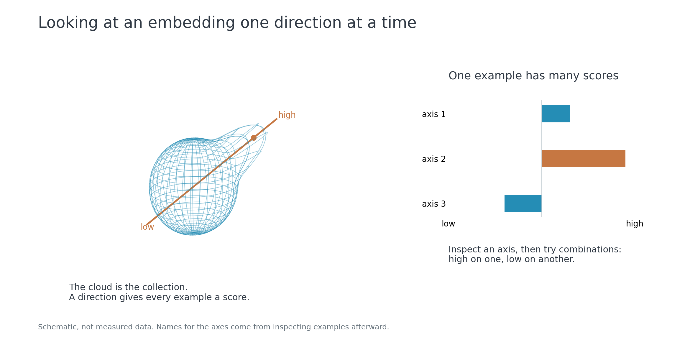

# ICA-Embed

A small pipeline for extracting ICA component profiles from pretrained text and
image embeddings. It normalises the vectors, reduces and whitens them with PCA,
then fits ICA. Each item receives a score on every component. The output includes
the fitted transform, score profiles, metadata and low/high example IDs.

Text inputs include plain text, JSON/JSONL documents and a seven-book Harry Potter
EPUB. Text embeddings use Qwen3-Embedding-0.6B through MLX on Apple Silicon. The
font pipeline renders phrases in different typefaces and embeds them with SigLIP.
The shared `ComponentSpace` class handles both collections.

Optional combination searches use paired descriptions to interpret existing
components and rank passages by multiple scores. Component meanings are
provisional interpretations, not guaranteed semantic properties.



## Usage

Requires Python 3.12 and `uv`. Source code is in `src/`; local data, caches and
results are kept in the gitignored `ignore/` directory.

```bash
export UV_PROJECT_ENVIRONMENT="$PWD/ignore/venv"

# Text
uv run python -B -m src text prepare --source "/path/to/collection.epub"
uv run --extra text python -B -m src text embed
uv run python -B -m src text fit

# Fonts
uv run --extra fonts python -B -m src fonts prepare
uv run --extra fonts python -B -m src fonts embed
uv run python -B -m src fonts fit
```

Results are written to `ignore/results/text/` or `ignore/results/fonts/`.
Run `uv run --extra text python -B -m src combine` for combination searches,
using descriptions and query settings from `ignore/data/text/examples.json`.

## Background

The method uses standard PCA and ICA. Hyvärinen's
[introduction to ICA](https://www.cs.helsinki.fi/u/ahyvarin/whatisica.shtml)
describes the underlying assumptions. Related work on text representations includes
[WordICA](https://www.cs.helsinki.fi/u/ahyvarin/papers/Honkela10.pdf).
